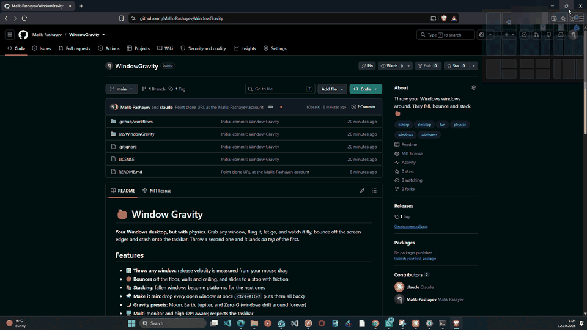

# 🍎 Window Gravity

**Your Windows desktop, but with physics.** Grab any window, fling it, let go, and watch it fly, bounce off the screen edges and crash onto the taskbar. Throw a second one and it lands *on top of* the first.



## Features

- 🪟 **Throw any window**: release velocity is measured from your mouse drag
- 🏀 **Bounces** off the floor, walls and ceiling, and slides to a stop with friction
- 📚 **Stacking**: fallen windows become platforms for the next ones
- 🌧 **Make it rain**: drop *every* open window at once (`Ctrl+Alt+Z` puts them all back)
- 🌙 **Gravity presets**: Moon, Earth, Jupiter, and Zero‑G (windows drift around forever)
- 🖥 Multi-monitor and high-DPI aware; respects the taskbar
- 🪶 No install, no admin rights, ~200 KB, lives in the system tray

## Hotkeys

| Hotkey | Action |
| --- | --- |
| `Ctrl+Alt+G` | Turn gravity on / off |
| `Ctrl+Alt+R` | Make it rain (drop all windows) |
| `Ctrl+Alt+Z` | Put windows back where they were |

Right-click the tray icon to change gravity, bounciness, or to exit.

## Run it

Download `WindowGravity.exe` from [Releases](../../releases) and double-click it. It needs the [.NET 9 Desktop Runtime](https://dotnet.microsoft.com/download/dotnet/9.0).

Or build it yourself:

```powershell
git clone https://github.com/Malik-Pashayev/WindowGravity.git
cd WindowGravity
dotnet run --project src/WindowGravity
```

## How it works

1. **Watching drags:** `SetWinEventHook` listens system-wide for `EVENT_SYSTEM_MOVESIZESTART/END`, which fire whenever you drag *any* window by its title bar.
2. **Measuring the throw:** while you drag, the window's position is sampled every ~10 ms. On release, the movement over the last 80 ms gives the throw velocity.
3. **Simulating:** a small physics loop (gravity, air drag, restitution, ground friction) runs at ~100 Hz and moves the window with `SetWindowPos`.
4. **Real edges:** Windows 10/11 windows have invisible resize borders, so the visible frame comes from `DwmGetWindowAttribute(DWMWA_EXTENDED_FRAME_BOUNDS)`. That way windows land *exactly* on the taskbar.

Resizes and Aero Snap are detected and ignored, and maximized or minimized windows are left alone.

## Limitations

- Windows of apps running **as administrator** can't be moved by a non-admin process (that's Windows security, by design).
- Windows only collide when one lands on top of another. There are no sideways collisions yet.

## Ideas / Roadmap

- [ ] Sideways window-to-window collisions
- [ ] "Earthquake" mode: shake the screen 🌋
- [ ] Spin windows that hit at an angle (just kidding... unless?)
- [ ] Sound effects on impact
- [ ] Start with Windows option

PRs welcome!

## License

[MIT](LICENSE)
